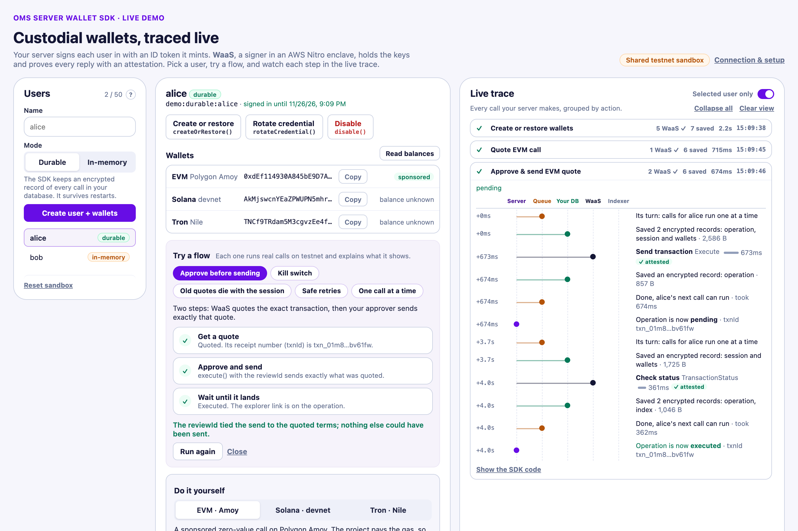
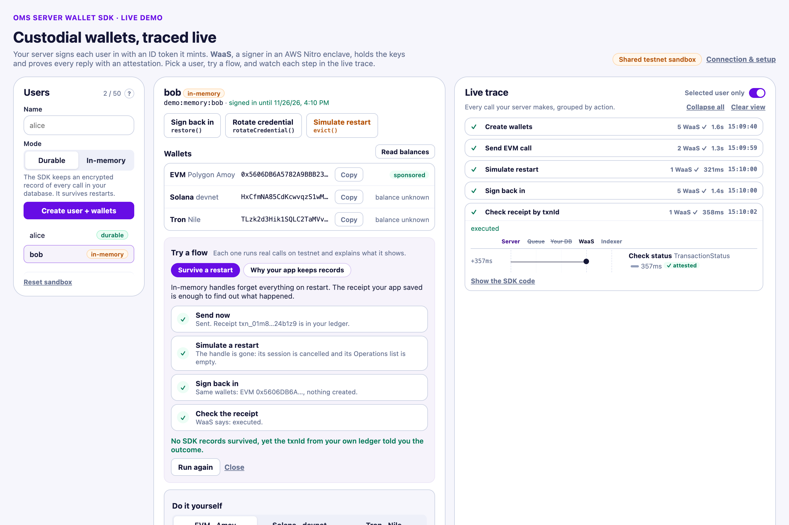

# Server wallet example

A small custodial wallet backend built on `@polygonlabs/oms-server-wallet-sdk`, with a browser app that
triggers actions and draws what happens: every WaaS request (and whether its response was attested),
each per-user lock, every encrypted state write, and each operation's status as it moves.

It runs both modes side by side, one per user:

- **Durable**: `createServerWalletService({ storage: { adapter, encryptionKey }, executor })`. State is
  encrypted by the SDK and written to the app's store (`.data/store.json` under Node, Durable Object
  storage on Cloudflare). Records, idempotency and the kill switch (`disable()`) survive restarts.
- **In-memory**: `createServerWalletService({ storage: 'memory' })`. Credentials and records live in
  this process. The app saves each `txnId` from `onPrepared` to its own ledger, and **Simulate restart**
  followed by **Check receipt** shows recovery from a handle with no records.

Live: <https://oms-server-wallet-example.0xsequence.workers.dev> (a shared testnet sandbox).





Everything runs on testnets: sponsored zero-value calls on Polygon Amoy (no funds needed), and native
transfers on Solana devnet and Tron Nile, which are not sponsored: the demo shows each wallet's
balance and links its faucet until it is funded. Guided flows walk through each behaviour, and
every step shows up in the live trace.

## Run it locally

```sh
cp examples/server-wallet/.env.example examples/server-wallet/.env.local   # then fill it in
pnpm dev:server-wallet-example                                             # http://localhost:5190
```

One process serves the API, the browser app (Vite in middleware mode) and the live event stream.
Nothing has to be deployed, except that WaaS must be able to verify your ID tokens.

### The ID token issuer

The SDK signs each user in with an ID token your backend mints, so WaaS needs an issuer it trusts:
an `OIDC_ISSUER` registered in your WaaS project, whose discovery document and JWKS are reachable
from the internet. Either:

- **reuse an issuer you already have**: put its URL, audience and ES256 private JWK in `.env.local`;
- **use this server as the issuer**: run `pnpm --filter server-wallet-example keygen` for a key,
  expose port 5190 with a tunnel (for example `cloudflared tunnel --url http://localhost:5190`), set
  `OIDC_ISSUER` to the tunnel URL and register it in your WaaS project. This server serves
  `/.well-known/openid-configuration` and `/oidc/jwks` for it.

`.data/` holds the demo's state; delete it to start over.

## Deploy to Cloudflare Workers

[`server/worker.ts`](server/worker.ts) runs the same app in one Durable Object: its storage is the
durable store, and a single instance keeps the per-user lock and in-memory handles correct. When
Cloudflare evicts the idle object, in-memory handles go with it, as in a restart.

```sh
cd examples/server-wallet
cp .env.local .dev.vars && pnpm dev:worker   # the Worker locally, on http://localhost:5191
pnpm deploy                                  # builds, then wrangler deploy
npx wrangler secret bulk secrets.json        # once: the .env.local values as a JSON object
```

Anyone with the URL can create users and send sponsored testnet transactions, and everyone sees the
same users and trace. Keep it on testnet keys.

## Where to look

- [`server/wallets.ts`](server/wallets.ts): the SDK setup for both modes, the actions, and the
  `fetch`, store and executor wrappers that feed the trace.
- [`server/app.ts`](server/app.ts): the HTTP routes and the event stream, as one fetch handler for
  both [`server/main.ts`](server/main.ts) (Node) and [`server/worker.ts`](server/worker.ts).
- [`server/oidc.ts`](server/oidc.ts): minting ES256 ID tokens and publishing the JWKS.
- [`src/App.tsx`](src/App.tsx): the browser app, built with [UI SDK](https://ui-sdk.dev) components.
  It never imports the SDK.
- [`src/flows.ts`](src/flows.ts): the guided flows (approve before sending, kill switch, old quotes
  die with the session, safe retries, one call at a time, surviving a restart), and
  [`src/explain.ts`](src/explain.ts): the plain names and SDK code shown in the trace.
