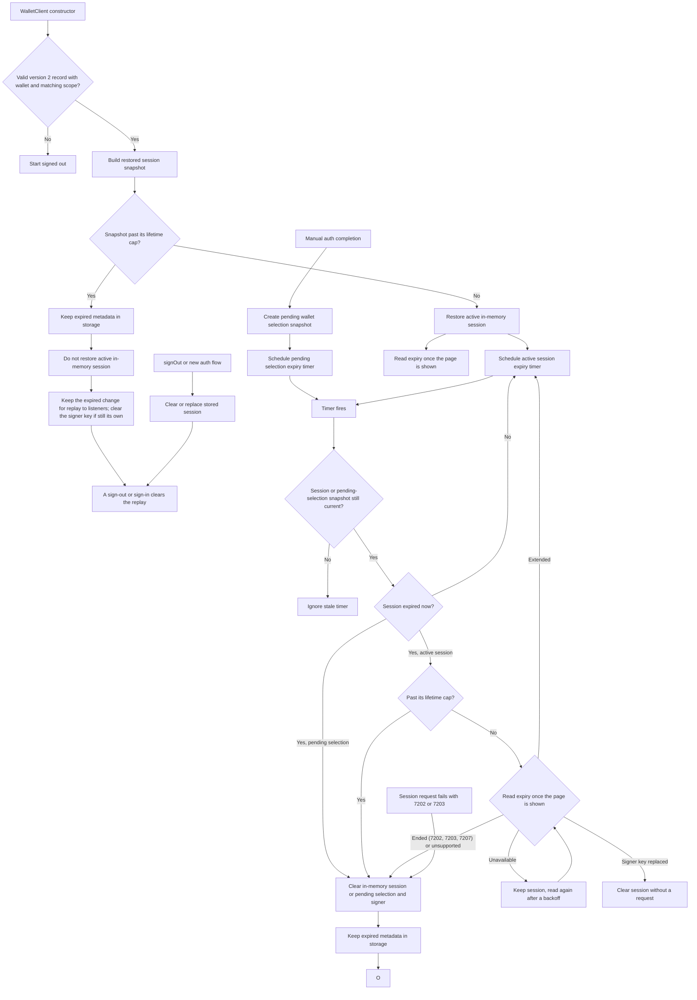

# Session Expiry Flow

This note documents the wallet session expiry flow for maintainers. Public API behavior is covered in `API.md`; this file focuses on how restored, active, and stale expiry paths are coordinated.

## Behavior Contract

- `expiresAt` is the credential's current expiry, not a fixed end. WaaS slides it forward with use (up to the lifetime requested at sign-in), and the SDK refreshes it with `GetCredential`.
- A valid stored session is restored into memory, gets an expiry timer, and refreshes its expiry in the background. Reading the expiry extends an active session, so in a browser page that is hidden or prerendering the restore read waits until the page is visible and no longer prerendering; without a `document` (Node, workers) it runs right away.
- A stored session whose saved expiry has passed may still be active on WaaS: requests after the last read can have moved the server expiry. Unless its lifetime cap has passed, it is restored as active and the restore read decides: WaaS extends it or reports it ended. Past the cap, it is discarded without asking WaaS: it is not restored as active, but its metadata stays in storage so its `expired` change is replayed to listeners after a page refresh. A session that a read ended keeps its record without its signing key; a later load finds the key missing and ends it the same way, so the expiry replays there too.
- A session active in memory can expire from the timer or from a protected wallet operation checking the session before use. Past the lifetime cap both end the session without a request; otherwise both check the expiry with WaaS first and only expire the session when WaaS reports the credential gone or revoked, the server has no `GetCredential`, or the refresh returns an expiry that has already passed.
- WaaS ends a session about 10 days after its last use, and never later than its lifetime cap. Every session-signed request moves the server expiry toward 10 days after it, capped at the lifetime cap, and so does `GetCredential` itself. See [Expiry check timing](#expiry-check-timing).
- A request signed with the active session's credential that fails with `KeyNotFound` (7202) or `KeyExpired` (7203) ends the session like a local expiry and fails with `OMS_SESSION_EXPIRED`, shaped like a local expiry (the WaaS error is only its `cause`, no `upstreamError`). This includes `Execute`, which the credential middleware rejects before it runs; a status lookup after submission keeps `OMS_TRANSACTION_STATUS_LOOKUP_FAILED` and its `txnId`. Only session-signed requests count (the session client's fetch records the rejection): public requests such as `inspectRemoteCredential` or signature verification can return 7202 for another credential and leave the session alone. `Unauthorized` (7207) from a session request is a request error and keeps the session; from `GetCredential`, which involves no wallet, it means the credential was revoked and ends the session. WaaS errors are matched by code: the API gateway also returns errors named `Unauthorized` (code 1000). Sign-in requests made without an active session are not affected.
- A successful session request refreshes the expiry in the background when the last read (sign-in or refresh) is at least 6 hours old.
- Pending manual wallet selection uses the same auth metadata and expiry timer before a wallet is activated. It expires locally without a refresh.
- `signOut()` or a new auth flow clears or replaces stored session metadata, which cancels stale expired-session replay.
- Sessions saved by SDK 0.3.x are under unscoped keys that 0.4.0 does not read, so they are not restored. Records under this project's key that are not version 2, are malformed, lack a valid lifetime cap (pre-release 0.4.0 builds), or have a different scope are deleted on load and never replayed; the user signs in again.

Activating another wallet of the active session (`useWallet`, `claimWallet`, `createWallet`, an import) keeps the session's current expiry, lifetime cap, and last read: a read applied while the activation was in flight is not overwritten by the expiry captured before it.

## Expiry Check Timing

Sign-in derives the lifetime cap from `CompleteAuth`, sent at `C0` and asking for lifetime `R`, whose response reports expiry `L0`: WaaS sets the new credential's expiry to the earlier of 10 days after the request and the lifetime, so the cap is `N = max(C0 + R, L0)`. WaaS never moves the expiry past `N`. It is kept with the session and stored in its record (`expiryCeiling`); a restore loads it. A sign-in whose `L0` is not after `C0` leaves it unknown, and such a session is not restored.

When the session's local expiry `L` (the expiry WaaS last reported) passes:

- Past the cap (`now >= N`), the session ends as expired without a request: nothing can have extended it. This applies to the timer, a protected operation, a restore, and a device that is offline.
- Otherwise WaaS decides. The timer fires at `L` and reads the expiry with `GetCredential` once the page is visible, as the restore read does; a protected operation reads it right away. An extended session is kept and the timer rescheduled; a session WaaS reports ended, or whose reported expiry has already passed, ends as expired; without `GetCredential` the local expiry is final.
- A read that cannot reach WaaS keeps the session and is retried after 1 minute, doubling to 15, each time once the page is visible, until a read succeeds or the session ends. A retry is skipped when another read (such as a protected operation's) has succeeded since it was scheduled. Only one such read is pending at a time: the timer joins a restore read still waiting for the page to be shown.

The read extends a live session like any signed request. That is intended: the page is open and visible when it happens, and the read becomes the session's last use, so the next read after the new expiry finds the session ended unless something else used it. With the page open and an accurate device clock, an ended session is noticed at its expiry.

## Expiry Refresh

One internal primitive reads the expiry with `GetCredential`. Concurrent callers share one in-flight request, and a result is applied only if the same session (session revision and signer credential) is still current. Before reading, it checks that the signer still holds the session's key (the same check protected operations make); if the key was removed or replaced, for example by a sign-in in another tab, the session is ended without a request. When the stored record is still this session's and the signer holds no key, the session ended on its own (expiry, or WaaS rejecting it) here or in another tab: it ends as expired and keeps its record. When the stored session now belongs to the signer's key, that newer session (such as another tab's) keeps its stored record, key, and pending OIDC redirect state; only this client's session state is dropped, as `signedOut` (or `expired` when its local expiry had passed). Protected operations handle a missing or replaced key the same way.

WaaS requires each signed request's nonce to be higher than the credential's last one, so an expiry read never overlaps another session-signed request: it waits until none is in flight, and session requests started during a read wait for it to finish before they are signed. A signed request that WaaS still rejects for its nonce (`PreconditionFailed`, 7206, HTTP 412) is signed again with a fresh nonce and resent, at most twice; WaaS rejects it before running any method, so this is safe for writes such as `Execute`.

| Outcome | Meaning | Effect |
|---|---|---|
| `refreshed` | WaaS returned a parseable `credential.expiresAt` | Session expiry set (later or earlier), timer rescheduled. When the stored record is this credential's, only its expiry is updated, so a wallet another tab activated stays stored; a record of another credential is left alone |
| `ended` | `KeyNotFound` (7202), `KeyExpired` (7203), or `Unauthorized` (7207, credential revoked) | Session ended as on local expiry; listeners receive `expired` once |
| `unsupported` | `WebrpcBadRoute` (servers without `GetCredential`, or a misrouted request) | Local expiry kept; not asked again for 15 minutes, then the next read asks once more |
| `unavailable` | Network or any other error | Session unchanged |
| `stale` | Session replaced or signed out while in flight | Result ignored |
| `signerMismatch` | The signer no longer holds the session's key (or reports none) and another sign-in replaced it; no request was sent | Session cleared as by a protected operation; listeners receive `signedOut`, and an operation fails with `No active wallet session`. A missing key whose record is still this session's is `ended` instead |

| Trigger | Where | On `unavailable` |
|---|---|---|
| Session restored from storage | End of the `WalletClient` constructor, fire-and-forget; a hidden or prerendering page waits until it is shown | Keep the session and read again after 1 minute, doubling up to 15 minutes, once the page is shown |
| Expiry timer fires at the local expiry, before the lifetime cap | `expireSessionFromTimer`, then the same read as a restore | Same as a restore |
| Operation finds the session locally expired | `requireActiveSession` | Throw the request error; the session is kept |
| Successful session request, last read at least 6 hours old | The session client's fetch wrapper | Nothing |
| Session request fails with `Unauthorized` (7207): an access error or a revoked credential | The session client's fetch wrapper, unless a read is in flight | Nothing; a 7207 from the read itself ends the session |

## Session changes and tabs

Every change of `activeWallet` or `session` is published once through `publishSessionChange`, which compares the getters' values with the last published ones (an `expired` change is published even when they did not change, as for a pending wallet selection). Listeners run in a microtask, never during the call that made the change, each with the listeners registered when it happened. `clearSession` publishes once its cleanup has finished, and only if no newer change happened meanwhile. The last `expired` change is replayed to listeners added while signed out; `signOut()` and sign-in starts clear it.

Tabs of one origin share the stored record and the default signer's key. A `storage` event for the session key, or the page becoming visible, runs `reconcileWithStoredSession`, which reads storage and the signer and never writes them:

- No stored record: another tab signed out or started a sign-in; this client's session ends as `signedOut`.
- The same sign-in: a key that is gone ends the session as above; otherwise the stored wallet and a later stored expiry are adopted (`walletChanged` or `expiryUpdated`).
- Another sign-in: adopted as `signedIn` when its expiry has not passed and the signer holds its key, with no restore read. Anything changing meanwhile runs the reconcile again.

## Flow

