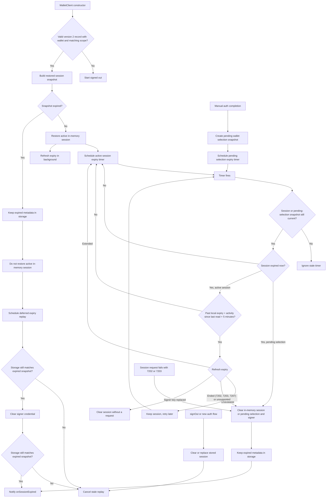

# Session Expiry Flow

This note documents the wallet session expiry flow for maintainers. Public API behavior is covered in `API.md`; this file focuses on how restored, active, and stale expiry paths are coordinated.

## Behavior Contract

- `expiresAt` is the credential's current expiry, not a fixed end. WaaS slides it forward with use (up to the lifetime requested at sign-in), and the SDK refreshes it with `GetCredential`.
- A valid stored session is restored into memory, gets an expiry timer, and refreshes its expiry in the background.
- An expired stored session is discarded on restore without asking WaaS: it is not restored as active, but its metadata stays in storage so `onSessionExpired` can replay after a page refresh.
- A session active in memory can expire from the timer or from a protected wallet operation checking the session before use. Both check the expiry with WaaS first and only expire the session when WaaS reports the credential gone or revoked, the server has no `GetCredential`, or the refresh returns an expiry that has already passed.
- WaaS ends a session about 10 days after its last use. Every session-signed request moves the server expiry to an idle window after it, and so does `GetCredential` itself, so the timer does not read the expiry while the session may still be active: at the local expiry it waits for the activity since the last successful read (the time from that read's send to the last session request's send) plus a 5-minute grace period, then reads. Without SDK activity, the SDK notices an idle session's end up to 5 minutes after it. A protected operation on a locally expired session reads the expiry immediately.
- A request signed with the active session's credential that fails with `KeyNotFound` (7202) or `KeyExpired` (7203) ends the session like a local expiry and fails with `OMS_SESSION_EXPIRED`, shaped like a local expiry (the WaaS error is only its `cause`, no `upstreamError`). This includes `Execute`, which the credential middleware rejects before it runs; a status lookup after submission keeps `OMS_TRANSACTION_STATUS_LOOKUP_FAILED` and its `txnId`. Only session-signed requests count (the session client's fetch records the rejection): public requests such as `inspectRemoteCredential` or signature verification can return 7202 for another credential and leave the session alone. `Unauthorized` (7207) from a session request is a request error and keeps the session; from `GetCredential`, which involves no wallet, it means the credential was revoked and ends the session. WaaS errors are matched by code: the API gateway also returns errors named `Unauthorized` (code 1000). Sign-in requests made without an active session are not affected.
- A successful session request refreshes the expiry in the background when the last read (sign-in or refresh) is at least 6 hours old.
- Pending manual wallet selection uses the same auth metadata and expiry timer before a wallet is activated. It expires locally without a refresh.
- `signOut()` or a new auth flow clears or replaces stored session metadata, which cancels stale expired-session replay.
- Records that are not version 2 (SDK 0.3.x), are malformed, or have a different scope are deleted on load and never replayed.

## Expiry Refresh

One internal primitive reads the expiry with `GetCredential`. Concurrent callers share one in-flight request, and a result is applied only if the same session (session revision and signer credential) is still current. Before reading, it checks that the signer still holds the session's key (the same check protected operations make); if the key was removed or replaced, for example by a sign-in in another tab, the session is cleared without a request. When the stored session now belongs to the signer's key, that newer session (such as another tab's) keeps its stored record, key, and pending OIDC redirect state; only this client's session state is dropped. Protected operations handle a replaced key the same way.

WaaS requires each signed request's nonce to be higher than the credential's last one, so an expiry read never overlaps another session-signed request: it waits until none is in flight, and session requests started during a read wait for it to finish before they are signed. A signed request that WaaS still rejects for its nonce (`PreconditionFailed`, 7206, HTTP 412) is signed again with a fresh nonce and resent, at most twice; WaaS rejects it before running any method, so this is safe for writes such as `Execute`.

| Outcome | Meaning | Effect |
|---|---|---|
| `refreshed` | WaaS returned a parseable `credential.expiresAt` | Session expiry set (later or earlier), stored record updated, timer rescheduled |
| `ended` | `KeyNotFound` (7202), `KeyExpired` (7203), or `Unauthorized` (7207, credential revoked) | Session ended as on local expiry; `onSessionExpired` fires once |
| `unsupported` | `WebrpcBadRoute` (servers without `GetCredential`) | Local expiry kept; remembered for the client's lifetime, so not retried |
| `unavailable` | Network or any other error | Session unchanged |
| `stale` | Session replaced or signed out while in flight | Result ignored |
| `signerMismatch` | The signer no longer holds the session's key; no request was sent | Session cleared as by a protected operation; an operation fails with `No active wallet session` |

| Trigger | Where | On `unavailable` |
|---|---|---|
| Session restored from storage | End of the `WalletClient` constructor, fire-and-forget | Nothing; the next session request retries |
| Expiry timer fires, once past the local expiry plus the activity since the last read plus 5 minutes | `expireSessionFromTimer` | Keep the session and check again after 1 minute, doubling up to 15 minutes |
| Operation finds the session locally expired | `requireActiveSession` | Throw the request error; the session is kept |
| Successful session request, last read at least 6 hours old | The session client's fetch wrapper | Nothing |

## Flow

