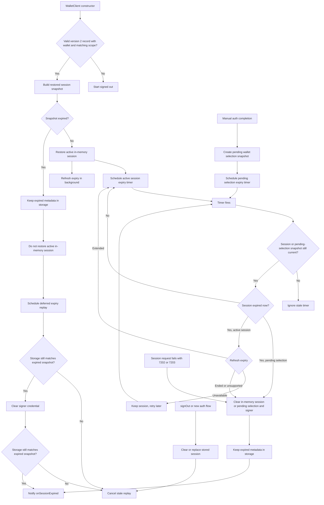

# Session Expiry Flow

This note documents the wallet session expiry flow for maintainers. Public API behavior is covered in `API.md`; this file focuses on how restored, active, and stale expiry paths are coordinated.

## Behavior Contract

- `expiresAt` is the credential's current expiry, not a fixed end. WaaS slides it forward with use (up to the lifetime requested at sign-in), and the SDK refreshes it with `GetCredential`.
- A valid stored session is restored into memory, gets an expiry timer, and refreshes its expiry in the background.
- An expired stored session is not restored as active, but its metadata stays in storage so `onSessionExpired` can replay after a page refresh.
- Active sessions can expire from the timer or from a protected wallet operation checking the session before use. Both refresh the expiry first and only expire the session when WaaS reports the credential gone or the server has no `GetCredential`.
- A request signed with the active session's credential that fails with `KeyNotFound` (7202) or `KeyExpired` (7203) ends the session like a local expiry and fails with `OMS_SESSION_EXPIRED`, shaped like a local expiry (the WaaS error is only its `cause`, no `upstreamError`). This includes `Execute`, which the credential middleware rejects before it runs; a status lookup after submission keeps `OMS_TRANSACTION_STATUS_LOOKUP_FAILED` and its `txnId`. Only session-signed requests count (the session client's fetch records the rejection): public requests such as `inspectRemoteCredential` or signature verification can return 7202 for another credential and leave the session alone. `Unauthorized` (7207) is not mapped, and sign-in requests made without an active session are not affected.
- A successful session request refreshes the expiry in the background when the last read (sign-in or refresh) is at least 6 hours old.
- Pending manual wallet selection uses the same auth metadata and expiry timer before a wallet is activated. It expires locally without a refresh.
- `signOut()` or a new auth flow clears or replaces stored session metadata, which cancels stale expired-session replay.
- Records that are not version 2 (SDK 0.3.x), are malformed, or have a different scope are deleted on load and never replayed.

## Expiry Refresh

One internal primitive reads the expiry with `GetCredential`. Concurrent callers share one in-flight request, and a result is applied only if the same session (session revision and signer credential) is still current.

WaaS requires each signed request's nonce to be higher than the credential's last one, so an expiry read never overlaps another session-signed request: it waits until none is in flight, and session requests started during a read wait for it to finish before they are signed.

| Outcome | Meaning | Effect |
|---|---|---|
| `refreshed` | WaaS returned a parseable `credential.expiresAt` | Session expiry set (later or earlier), stored record updated, timer rescheduled |
| `ended` | `KeyNotFound` (7202) or `KeyExpired` (7203) | Session ended as on local expiry; `onSessionExpired` fires once |
| `unsupported` | `WebrpcBadRoute` (servers without `GetCredential`) | Local expiry kept; remembered for the client's lifetime, so not retried |
| `unavailable` | Network or any other error | Session unchanged |
| `stale` | Session replaced or signed out while in flight | Result ignored |

| Trigger | Where | On `unavailable` |
|---|---|---|
| Session restored from storage | End of the `WalletClient` constructor, fire-and-forget | Nothing; the next session request retries |
| Expiry timer fires | `expireSessionFromTimer` | Keep the session and check again after 1 minute, doubling up to 15 minutes |
| Operation finds the session locally expired | `requireActiveSession` | Throw the request error; the session is kept |
| Successful session request, last read at least 6 hours old | The session client's fetch wrapper | Nothing |

## Flow

