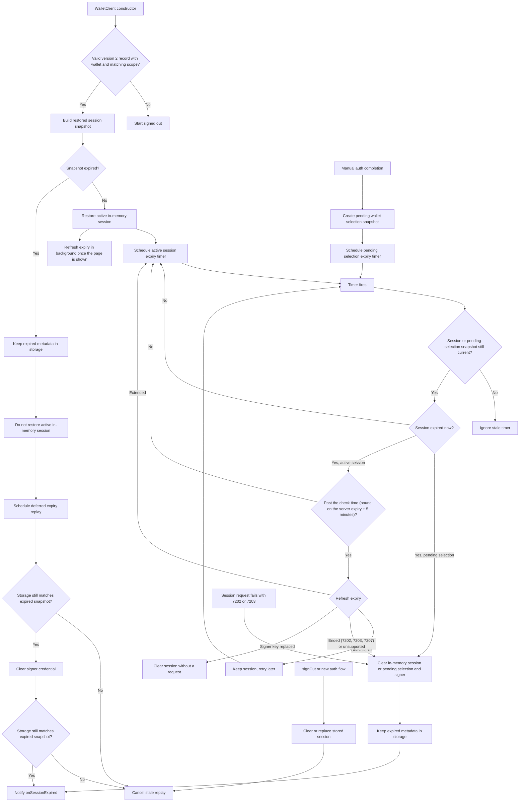

# Session Expiry Flow

This note documents the wallet session expiry flow for maintainers. Public API behavior is covered in `API.md`; this file focuses on how restored, active, and stale expiry paths are coordinated.

## Behavior Contract

- `expiresAt` is the credential's current expiry, not a fixed end. WaaS slides it forward with use (up to the lifetime requested at sign-in), and the SDK refreshes it with `GetCredential`.
- A valid stored session is restored into memory, gets an expiry timer, and refreshes its expiry in the background. Reading the expiry extends an active session, so in a browser page that is hidden or prerendering the restore read waits until the page is visible and no longer prerendering; without a `document` (Node, workers) it runs right away.
- A stored session whose saved expiry has passed may still be active on WaaS: requests after the last read can have moved the server expiry, which is therefore normally less than 12 hours (the 6-hour dampening plus the 6 hours until the next read) past the saved one, never past the ceiling. Within that window (plus the 5-minute grace) it is restored as active, and the restore read decides: WaaS extends it or reports it ended. Past the window or the ceiling, it is discarded without asking WaaS: it is not restored as active, but its metadata stays in storage so `onSessionExpired` can replay after a page refresh. The window assumes each read succeeded and was saved; a missed one can leave the server expiry later, which only ends the session early. A session that a read ended keeps its record without its signing key; a later load inside the window finds the key missing and ends it the same way, so the expiry replays there too.
- A session active in memory can expire from the timer or from a protected wallet operation checking the session before use. Both check the expiry with WaaS first and only expire the session when WaaS reports the credential gone or revoked, the server has no `GetCredential`, or the refresh returns an expiry that has already passed.
- WaaS ends a session about 10 days after its last use. Every session-signed request moves the server expiry toward an idle window after it, capped at the lifetime requested at sign-in, and so does `GetCredential` itself, so the timer does not read the expiry while the session may still be active. See [Expiry check timing](#expiry-check-timing). A protected operation on a locally expired session reads the expiry immediately.
- A request signed with the active session's credential that fails with `KeyNotFound` (7202) or `KeyExpired` (7203) ends the session like a local expiry and fails with `OMS_SESSION_EXPIRED`, shaped like a local expiry (the WaaS error is only its `cause`, no `upstreamError`). This includes `Execute`, which the credential middleware rejects before it runs; a status lookup after submission keeps `OMS_TRANSACTION_STATUS_LOOKUP_FAILED` and its `txnId`. Only session-signed requests count (the session client's fetch records the rejection): public requests such as `inspectRemoteCredential` or signature verification can return 7202 for another credential and leave the session alone. `Unauthorized` (7207) from a session request is a request error and keeps the session; from `GetCredential`, which involves no wallet, it means the credential was revoked and ends the session. WaaS errors are matched by code: the API gateway also returns errors named `Unauthorized` (code 1000). Sign-in requests made without an active session are not affected.
- A successful session request refreshes the expiry in the background when the last read (sign-in or refresh) is at least 6 hours old.
- Pending manual wallet selection uses the same auth metadata and expiry timer before a wallet is activated. It expires locally without a refresh.
- `signOut()` or a new auth flow clears or replaces stored session metadata, which cancels stale expired-session replay.
- Sessions saved by SDK 0.3.x are under unscoped keys that 0.4.0 does not read, so they are not restored. Records under this project's key that are not version 2, are malformed, lack a valid idle window and expiry ceiling (pre-release 0.4.0 builds), or have a different scope are deleted on load and never replayed; the user signs in again.

Activating another wallet of the active session (`useWallet`, `claimWallet`, `createWallet`, an import) keeps the session's current expiry, bounds, and last read: a read applied while the activation was in flight is not overwritten by the expiry captured before it.

## Expiry Check Timing

Sign-in derives two bounds from `CompleteAuth`, sent at `C0` and asking for lifetime `R`, whose response reports expiry `L0`: WaaS sets the new credential's expiry to the earlier of an idle window after the request and the lifetime, so the idle window is `I = L0 - C0` and the ceiling is `N = max(C0 + R, L0)`. Both are kept with the session and stored in its record (`idleWindowMs`, `expiryCeiling`); a restore loads them.

WaaS moves the expiry of an active credential toward `min(t + I, N)` on each session-signed request at `t`, but writes the move only when it reaches `N` or is at least 6 hours (WaaS `SlideDampening`), so a read can return less than an idle window after it. That dampening only keeps the server expiry lower, so after the last request the server expiry is at most `min(A + I, N)`, and it never drops below `L`, the expiry the server last reported.

When the session is locally expired at `L`, the timer reads the expiry at:

- `L + 5 minutes` when no session-signed request completed after the last successful read (`A <= C`).
- Otherwise `max(L, min(A + I, N)) + 5 minutes`. With a lifetime shorter than the idle window, the expiry is `N` from sign-in and activity cannot move it, so this is `L + 5 minutes`.
- `L + max(0, A - C) + 6 hours + 5 minutes` (or `L + 6 hours + 5 minutes` without a read) if the bounds are unknown, which only a sign-in response without a usable expiry leaves.

Before that, the timer re-arms for the computed time, checking again on each fire. `C` is the sign-in request's send time or the completion of the last successful `GetCredential` in this client; a restore leaves it unset until a read succeeds. `A` is the completion (response or error) of the last session-signed request: a request can reach WaaS until then. It includes every `GetCredential` (the restore read, the 6-hour background read, the read before an operation), whatever its outcome, since WaaS may have extended the credential when the response was lost, except the timer's own reads: those are sent past the bound, so if they reach WaaS the credential has ended there, and a failed one is retried after the backoff delay. A restore sets `A` to the restore time, which bounds the requests of the process that stored the session.

Tabs share the last-activity time: each session-signed request also writes `{ signerCredentialId, at }` to the session storage (`omsWallet_session_activity:<projectId>@<wallet API origin>`, best effort), and the timer uses the later of its own `A` and that record when the record names this session's credential. Sign-out deletes the record; a client whose session was replaced by another tab's sign-in leaves it alone.

Without SDK activity, the SDK notices an idle session's end up to about 6 hours after it, because WaaS writes an extension only when it moves the expiry by at least 6 hours (within 5 minutes when the lifetime is shorter than the idle window). This assumes an accurate device clock and a page open in the foreground. The timer never reads by the saved expiry of a restored session alone: a read or a save that was missed before the restore can leave the server expiry later than any bound derived from it, and reading a live credential would extend an idle session. Instead, a restore read that could not reach WaaS is retried with a backoff (1 minute, doubling to 15) while no read has succeeded, each time once the page is shown, where reading counts as use. With the page never shown and no wallet call, the end can be noticed up to an idle window after the restore. When the read finds WaaS without `GetCredential`, the timer ends a locally expired session at once.

## Expiry Refresh

One internal primitive reads the expiry with `GetCredential`. Concurrent callers share one in-flight request, and a result is applied only if the same session (session revision and signer credential) is still current. Before reading, it checks that the signer still holds the session's key (the same check protected operations make); if the key was removed or replaced, for example by a sign-in in another tab, the session is cleared without a request. When the stored session now belongs to the signer's key, that newer session (such as another tab's) keeps its stored record, key, and pending OIDC redirect state; only this client's session state is dropped. Protected operations handle a replaced key the same way.

WaaS requires each signed request's nonce to be higher than the credential's last one, so an expiry read never overlaps another session-signed request: it waits until none is in flight, and session requests started during a read wait for it to finish before they are signed. A signed request that WaaS still rejects for its nonce (`PreconditionFailed`, 7206, HTTP 412) is signed again with a fresh nonce and resent, at most twice; WaaS rejects it before running any method, so this is safe for writes such as `Execute`.

| Outcome | Meaning | Effect |
|---|---|---|
| `refreshed` | WaaS returned a parseable `credential.expiresAt` | Session expiry set (later or earlier), timer rescheduled. When the stored record is this credential's, only its expiry is updated, so a wallet another tab activated stays stored; a record of another credential is left alone |
| `ended` | `KeyNotFound` (7202), `KeyExpired` (7203), or `Unauthorized` (7207, credential revoked) | Session ended as on local expiry; `onSessionExpired` fires once |
| `unsupported` | `WebrpcBadRoute` (servers without `GetCredential`, or a misrouted request) | Local expiry kept; not asked again for 15 minutes, then the next read asks once more |
| `unavailable` | Network or any other error | Session unchanged |
| `stale` | Session replaced or signed out while in flight | Result ignored |
| `signerMismatch` | The signer no longer holds the session's key (or reports none); no request was sent | Session cleared as by a protected operation; an operation fails with `No active wallet session`. A background read (timer, restore, 6-hour, after `Unauthorized`) fires `onSessionExpired` instead, as nothing else reports it |

| Trigger | Where | On `unavailable` |
|---|---|---|
| Session restored from storage | End of the `WalletClient` constructor, fire-and-forget; a hidden or prerendering page waits until it is shown | Nothing; the next session request retries |
| Expiry timer fires, once past the check time in [Expiry check timing](#expiry-check-timing) | `expireSessionFromTimer` | Keep the session and check again after 1 minute, doubling up to 15 minutes |
| Operation finds the session locally expired | `requireActiveSession` | Throw the request error; the session is kept |
| Successful session request, last read at least 6 hours old | The session client's fetch wrapper | Nothing |
| Session request fails with `Unauthorized` (7207): an access error or a revoked credential | The session client's fetch wrapper, unless a read is in flight | Nothing; a 7207 from the read itself ends the session |

## Flow

